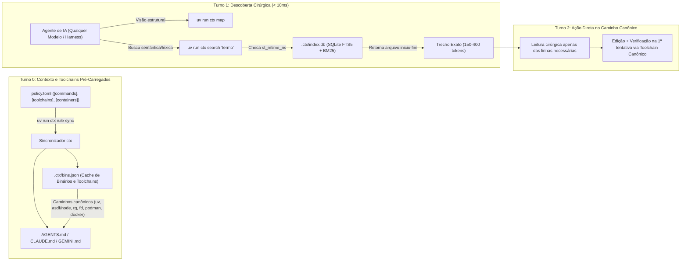
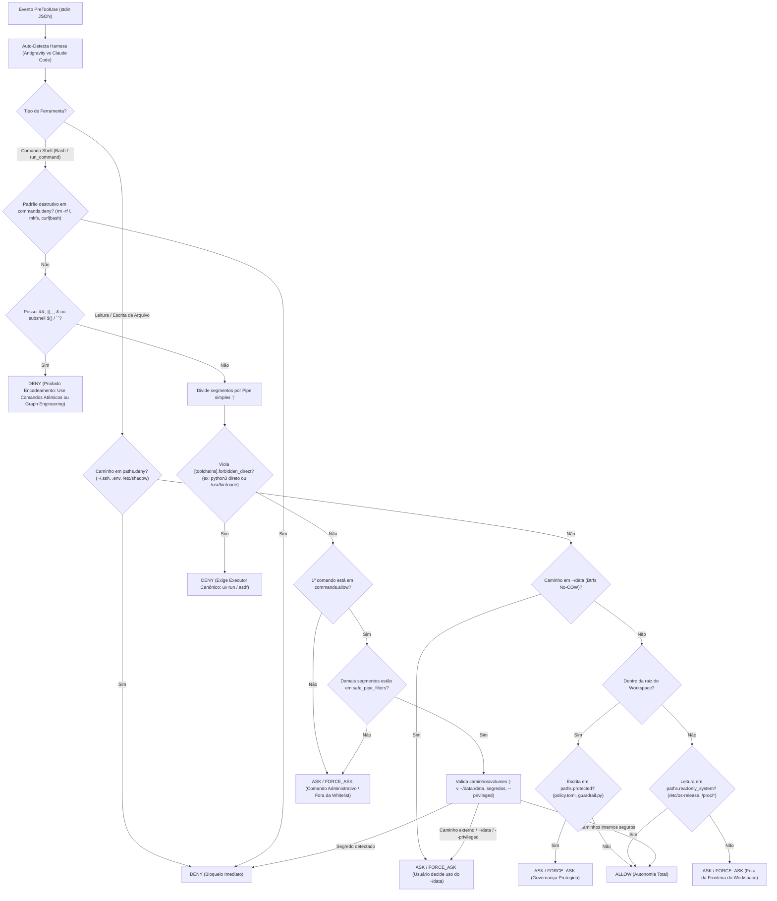
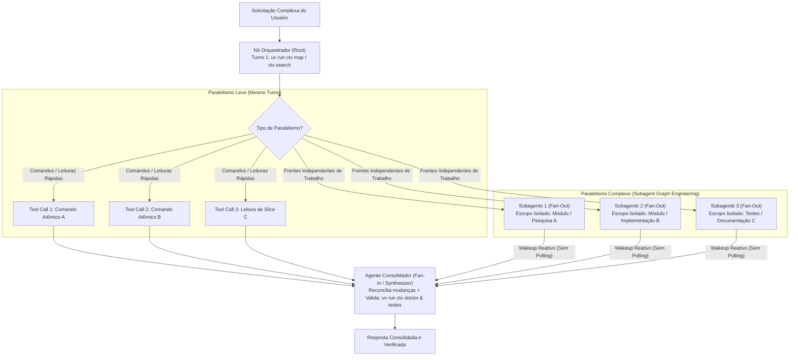
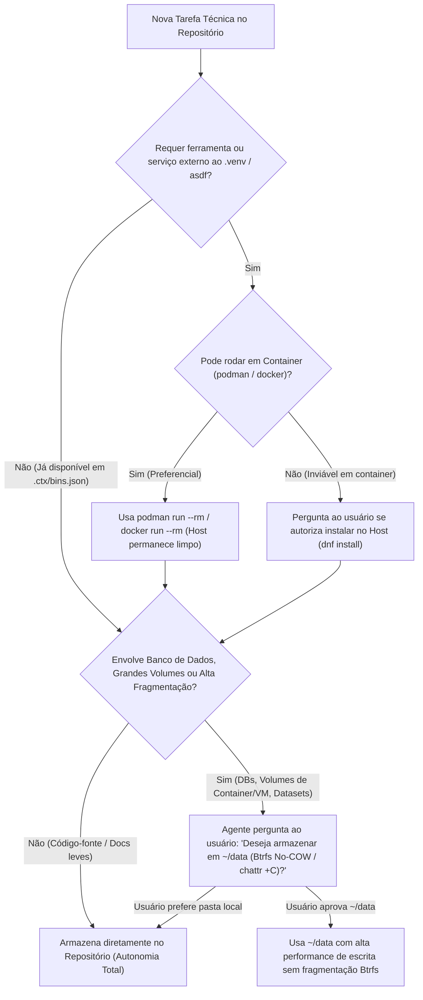

# Guia de Replicação: RAG Local Ultra-Performático (`ctx`), Cache de Binários, Toolchains Canônicos e Motor Universal de Autonomia com Segurança

Este guia é **100% agnóstico de repositório** e documenta a arquitetura completa, o racional técnico de cada ferramenta escolhida, os diagramas de fluxo (incluindo **Graph Engineering** para paralelismo sem encadeamento no shell) e o passo a passo para replicar o motor **`ctx`** em **qualquer outro repositório ou projeto** em menos de 2 minutos.

---

## 1. Visão Geral da Arquitetura e Descoberta em 1 Turno

O sistema foi desenhado com **zero dependências externas** (100% biblioteca padrão do Python 3.11+: `sqlite3`, `ast`, `tomllib`, `shlex`, `pathlib`) para eliminar quatro gargalos clássicos de agentes de IA em qualquer modelo (de modelos leves/rápidos a modelos de fronteira) e qualquer harness (Antigravity/AGY, Claude Code, CLI):

1. **Fim da exploração cega de arquivos (`ctx map` e `ctx search` em `< 10ms`)**:
   - Em vez de gastar 4 a 8 turnos executando `ls`, `find` e lendo arquivos inteiros, o agente executa `uv run ctx map` ou `uv run ctx search "<termo>"` no **Turno 1**.
   - O indexador (`src/ctx/rag.py`) divide arquivos Markdown por seções (`#`, `##`, `###`) e arquivos Python pela árvore sintática (`ast.ClassDef`, `ast.FunctionDef`, `ast.AsyncFunctionDef`), gravando em `.ctx/index.db` (SQLite FTS5 com tokenizador `unicode61 remove_diacritics 2` e ranking **BM25**).
   - Antes de cada consulta, apenas arquivos cujo `st_mtime_ns` ou tamanho mudaram são reindexados incrementalmente em milissegundos.
2. **Fim das buscas repetitivas por binários (`ctx bins` e `.ctx/bins.json` em `< 1ms`)**:
   - Modelos de linguagem costumam desperdiçar turnos rodando `which`, `whereis` ou `type` a cada solicitação para descobrir se ferramentas como `rg`, `fd`, `podman`, `docker`, `asdf`, `node` ou `uv` estão instaladas e em qual caminho.
   - O comando `uv run ctx bins` (executado automaticamente no `ctx rule sync`) pré-resolve e persiste todos os caminhos e toolchains em `.ctx/bins.json` e injeta a lista de binários verificados diretamente no `AGENTS.md` (**Turno 0**).
3. **Enforcement Agnóstico de Toolchains (`[toolchains]` em `policy.toml`) e Obediência na 1ª Tentativa**:
   - Modelos frequentemente tentam "atalhos" invocando `python3` diretamente (em vez de `uv run`) ou `/usr/bin/node` do sistema (em vez do shim gerenciado pelo `asdf`).
   - A seção `[toolchains]` define declarativamente o executor canônico de cada linguagem/stack e os binários diretos proibidos (`forbidden_direct`). O `scripts/guardrail.py` **recusa imediatamente (`deny`)** qualquer tentativa de usar o binário errado e instrui o modelo a usar o caminho canônico já na 1ª tentativa.
4. **Autonomia com Segurança Multi-Harness + Graph Engineering (`scripts/guardrail.py` em `< 5ms`)**:
   - Uma única fonte de verdade (`policy.toml`) compila as regras simultaneamente para Antigravity (`.agents/hooks.json`, `GEMINI.md`) e Claude Code (`.claude/settings.json`, `CLAUDE.md`), além do documento mestre `AGENTS.md`.
   - Comandos encadeados no shell (`&&`, `||`, `;`, `&`, subshells) são **recusados (`deny`)**, direcionando toda paralelização para o **Graph Engineering** nativo do harness (DAG *Fan-Out* paralelo + **Agente Consolidador** *Fan-In*).

### Diagrama 1: Arquitetura de Descoberta em 1 Turno (RAG + Mapa + Cache de Binários + Toolchains)



---

## 2. Vantagens da Abordagem e Motivo Técnico da Escolha de Cada Ferramenta

Cada componente desta arquitetura foi selecionado por motivos técnicos estritos de **latência, portabilidade, isolamento e durabilidade do sistema operacional**:

| Componente / Ferramenta | Papel na Arquitetura | Motivo Técnico da Escolha e Vantagens |
| :--- | :--- | :--- |
| **SQLite FTS5 + BM25 (`sqlite3` stdlib)** | Motor de busca local (`.ctx/index.db`) | Nativo no Python (zero pacotes C/Rust externos, zero containers ou GPU para embeddings). Com WAL ativado e tokenizador `unicode61 remove_diacritics 2`, entrega buscas rankeadas por BM25 em **2ms a 8ms** mesmo em milhares de blocos, lidando perfeitamente com acentuação em português e identificadores de código. |
| **Chunking por AST (`ast` stdlib) + Cabeçalhos Markdown** | Indexação estrutural (`src/ctx/rag.py`) | Ao contrário de divisores por tamanho fixo de caracteres que cortam funções ao meio, o parser AST do Python extrai `ClassDef` e `FunctionDef` com linhas iniciais e finais exatas (`arquivo:inicio-fim`). Isso permite que modelos menores/rápidos leiam apenas a função relevante. |
| **Cache de Binários (`.ctx/bins.json` / `ctx bins`)** | Resolução prévia de ferramentas, runtimes e comandos | Elimina 1 a 3 turnos de sondagem (`which`, `whereis`, `--version`) no início de cada tarefa. O agente já recebe no prompt (`AGENTS.md`) onde estão `uv`, `asdf`, `node`, `rg`, `fd`, `podman`, `docker` e `sqlite3`. |
| **`policy.toml` + `[toolchains]` (`tomllib` stdlib)** | Fonte única declarativa de governança e toolchains | Formato legível por humanos, auditável em Git e parseado nativamente pelo Python 3.11+. Impede que agentes tentem binários errados (`python3` direto ou `/usr/bin/node`) e mantém `.claude/settings.json`, `.agents/hooks.json`, `AGENTS.md`, `CLAUDE.md` e `GEMINI.md` 100% sincronizados. |
| **`uv` (Astral)** | Executor canônico de Python (`[toolchains.python]`) | Resolve e executa ambientes virtuais em milissegundos (`uv run`), mantendo o `.venv` estritamente isolado dentro do repositório sem tocar no Python global do sistema operacional. |
| **`asdf` (`~/.asdf/shims`)** | Gerenciador canônico de versões para Node.js e outros runtimes (`[toolchains.nodejs]`) | Garante que `node`, `npm`, `npx` e outras linguagens rodem exatamente na versão declarada pelo projeto/usuário via shims do `asdf`, bloqueando binários globais defasados em `/usr/bin/node`. |
| **`rg` (ripgrep), `fd` (fd-find), `tree`, `jq`** | Ferramentas nativas de alta velocidade e economia de tokens | Escritas em Rust/C, respeitam `.gitignore` por padrão, consomem fração de CPU e produzem saídas enxutas ideais para janelas de contexto de LLMs. |
| **`podman` e `docker` (Política Container-First)** | Execução isolada de ferramentas e serviços externos | Evita instalar pacotes, bancos de dados ou runtimes diretamente no sistema operacional host (`dnf install`), mantendo a máquina limpa, reproduzível e imune a conflitos de bibliotecas. O Podman no Fedora opera nativamente em modo *rootless* (sem daemon privilegiado). |
| **Pasta `~/data` no Btrfs com `chattr +C` (No-COW)** | Armazenamento de alta performance para dados pesados/fragmentados | O sistema de arquivos padrão do Fedora é o **Btrfs** (Copy-on-Write). Em cargas de escrita aleatória intensa (bancos de dados SQLite/PostgreSQL/vetoriais, imagens de containers/VMs e grandes volumes), o Copy-on-Write gera severa fragmentação de extents e amplificação de escrita (*write amplification*). O atributo `chattr +C` (`NOCOW`) em `~/data` desativa o Copy-on-Write apenas nessa pasta, entregando performance de escrita contígua próxima a disco bruto. |

---

## 3. Fluxo Decisório do Guardrail Multi-Harness e Enforcement de `[toolchains]` (`scripts/guardrail.py`)

O hook universal `scripts/guardrail.py` intercepta chamadas `PreToolUse` tanto no **Antigravity (AGY)** quanto no **Claude Code**, executando em menos de 5ms sem dependências externas:

- **Auto-detecção de protocolo**:
  - Se o evento vier do **Antigravity**, retorna estritamente `{"decision": "allow" | "force_ask" | "deny", "reason": "..."}` (compatível com o parser `protojson` estrito do AGY).
  - Se o evento vier do **Claude Code**, retorna o objeto `hookSpecificOutput` com `permissionDecision: "allow" | "ask" | "deny"`.
- **Bloqueio Estrito (`deny`) de Encadeamento de Comandos**:
  - Qualquer comando contendo `&&`, `||`, `;`, `&` (background), quebras de linha ou subshells (`$()`, `` ` ``) recebe **`deny` imediato**, instruindo o agente a executar comandos atômicos ou usar **Graph Engineering**.
- **Enforcement Agnóstico de `[toolchains]` (`deny`)**:
  - Qualquer tentativa de invocar um binário listado em `toolchains.<stack>.forbidden_direct` (como `python3`, `.venv/bin/python`, `/usr/bin/node`, `/usr/bin/npm`) recebe **`deny` imediato** com a explicação exata do executor canônico (`uv run`, `asdf exec` / `~/.asdf/shims`).
- **Suporte inteligente a Pipes Seguros de Leitura (`allow`)**:
  - Um pipe simples `comando_allow | filtro_seguro` (onde o filtro pertence a `safe_pipe_filters`: `head`, `tail`, `rg`, `grep`, `wc`, `sort`, `uniq`, `jq`, `cut`, `tr`) é aprovado automaticamente (`allow`).

### Diagrama 2: Fluxo Decisório do Hook `scripts/guardrail.py` (Com `[toolchains]` e Bloqueio de Encadeamento)



---

## 4. Paralelismo via Graph Engineering (DAG Fan-Out + Agente Consolidador Fan-In)

Como o encadeamento de comandos no shell (`&&`, `||`, `;`, `&`) é bloqueado (`deny`) por segurança e auditabilidade, a arquitetura adota **Graph Engineering nativo do harness da IA** sempre que uma tarefa exige paralelismo:

1. **Nível 1 — Paralelismo Leve (Tool-Level Fan-Out)**:
   - Para executar múltiplos comandos atômicos de diagnóstico ou ler diferentes trechos de arquivos, o agente emite **múltiplas chamadas de ferramentas independentes no mesmo turno**. O próprio harness executa cada chamada em paralelo, passando cada comando individualmente pelo `guardrail.py`.
2. **Nível 2 — Paralelismo Complexo (Subagent DAG Fan-Out + Agente Consolidador Fan-In)**:
   - Para tarefas amplas (múltiplos módulos, pesquisa + implementação + testes independentes), o fluxo é modelado como um **Grafo Acíclico Direcionado (DAG)**:
     - **Nó Orquestrador (Root Planner)**: Executa `uv run ctx map` e `uv run ctx search` no Turno 1 e particiona o trabalho em pacotes independentes (garantindo que dois nós paralelos nunca editem o mesmo arquivo).
     - **Nós Trabalhadores em Paralelo (Fan-Out Workers)**: O Orquestrador dispara subagentes especializados concorrentes (`invoke_subagent` no Antigravity ou `Task`/`Agent` no Claude Code), cada um com janela de contexto limpa e objetivo cirúrgico.
     - **Agente Consolidador (Fan-In Synthesizer)**: Recebe reativamente as respostas de todos os subagentes (sem loops de polling), integra os artefatos, executa a bateria global de validação (`uv run python -m unittest discover -s tests -v` e `uv run ctx doctor`) e entrega o resultado unificado.

### Diagrama 3: Graph Engineering (DAG Fan-Out Paralelo + Agente Consolidador Fan-In)



---

## 5. Estratégia Container-First (`podman`/`docker`) e Armazenamento Btrfs (`~/data`)

A política estabelece duas regras operacionais de infraestrutura que protegem o sistema host e maximizam a performance de I/O:

1. **Regra Container-First (`[containers]` no `policy.toml`)**:
   - Precisa rodar um banco de dados (PostgreSQL, Redis, Qdrant), um linter específico, um conversor multimídia ou um runtime que não está no `.venv` nem no `asdf`?
   - **1ª Opção (Automática)**: Executar via container efêmero com `podman run --rm ...` ou `docker run --rm ...` montando apenas o diretório necessário do repositório.
   - **Exceção (Com Confirmação)**: Se a ferramenta exigir acesso direto ao hardware/sistema host e não puder rodar em container, o agente **pausa e pergunta ao usuário** se pode instalá-la na máquina host (`dnf install`).
2. **Regra Btrfs No-COW `~/data` (`[storage.btrfs_nocow]` no `policy.toml`)**:
   - A tarefa envolve criar ou manipular bancos de dados pesados, índices vetoriais, volumes de containers/VMs ou arquivos grandes sujeitos a alta fragmentação?
   - O agente **deve perguntar explicitamente ao usuário** se deseja armazenar esses dados em `~/data` (que possui `chattr +C` no Btrfs).
   - O guardrail mantém `~/data` com decisão `ask` / `force_ask`, garantindo que o usuário tenha sempre a palavra final.

### Diagrama 4: Fluxo Container-First e Decisão de Armazenamento Btrfs (`~/data`)



---

## 6. Arquivos que Compõem o Kit Portável

Para levar esta arquitetura completa para qualquer repositório (`/caminho/destino`), você só precisa copiar os seguintes arquivos (todos descobrem a raiz do repositório dinamicamente via `Path(__file__).resolve()`):

```text
meu-repositorio/
├── policy.toml                                  # Fonte única declarativa (allow, pipes, ask, deny, toolchains, containers, btrfs)
├── scripts/
│   └── guardrail.py                             # Hook PreToolUse universal (< 5ms, stdlib pura)
├── src/
│   └── ctx/
│       ├── __init__.py                          # Descoberta dinâmica da raiz do workspace
│       ├── cli.py                               # Entry point da CLI ctx (index, search, map, bins, rule, doctor)
│       ├── rag.py                               # Motor SQLite FTS5/BM25 + AST/Markdown chunker incremental
│       └── policy.py                            # Sincronizador multi-harness + cache .ctx/bins.json + doctor
└── .agents/
    └── skills/
        └── workspace-ctx/
            └── SKILL.md                         # Skill universal (1º turno, toolchains, Graph Engineering, Container-First e ~/data)
```

---

## 7. Passo a Passo de Replicação Agnóstica (Bootstrap em < 2 Minutos)

### Passo 1: Copiar os arquivos base para o repositório de destino

Defina `ORIGEM` (repositório onde o kit já está instalado) e `DESTINO` (qualquer novo repositório) e copie os arquivos:

```bash
mkdir -p /caminho/destino/src /caminho/destino/scripts /caminho/destino/.agents/skills /caminho/destino/.claude/skills
cp -r /caminho/origem/src/ctx /caminho/destino/src/
cp /caminho/origem/scripts/guardrail.py /caminho/destino/scripts/
cp /caminho/origem/policy.toml /caminho/destino/
cp -r /caminho/origem/.agents/skills/workspace-ctx /caminho/destino/.agents/skills/
cp -r /caminho/origem/.claude/skills/workspace-ctx /caminho/destino/.claude/skills/
```

### Passo 2: Registrar o entry point `ctx` no `pyproject.toml` do repositório de destino

No `pyproject.toml` do repositório de destino, garanta que o script `ctx` esteja registrado em `[project.scripts]`:

```toml
[project]
name = "meu-repositorio"
version = "0.1.0"
requires-python = ">=3.11"
dependencies = []

[project.scripts]
ctx = "ctx.cli:main"

[build-system]
requires = ["uv_build>=0.13.0,<0.14.0"]
build-backend = "uv_build"
```

> **Nota**: Se o repositório já possuir outro pacote em `src/<outro_pacote>`, adicione no `pyproject.toml`:
> ```toml
> [tool.uv.build-backend]
> module-name = ["<outro_pacote>", "ctx"]
> ```

Adicione também `.ctx/` e configurações locais ao `.gitignore` do repositório de destino:

```gitignore
# Local RAG index & binary cache
.ctx/

# Local harness overrides
.claude/settings.local.json
```

### Passo 3: (Opcional, em máquinas Linux com Btrfs) Preparar a pasta `~/data` com `chattr +C`

Caso replique a arquitetura em um computador com Fedora/Btrfs, o atributo `+C` (No-COW) deve ser aplicado no diretório vazio antes de criar arquivos dentro dele:

```bash
mkdir -p ~/data
chattr +C ~/data
lsattr -d ~/data
```

### Passo 4: Sincronizar Políticas, Gerar Cache de Binários, Indexar e Auditar

No diretório do repositório de destino, execute os comandos atômicos:

```bash
uv run ctx rule sync
```

```bash
uv run ctx bins
```

```bash
uv run ctx index
```

```bash
uv run ctx doctor
```

Pronto! O comando `uv run ctx rule sync` terá criado automaticamente:
- `.ctx/bins.json` com todos os binários e toolchains resolvidos da máquina;
- `.claude/settings.json` e `.agents/hooks.json` apontando dinamicamente para o `scripts/guardrail.py` do repositório;
- `AGENTS.md`, `CLAUDE.md` e `GEMINI.md` contendo o mapa de binários verificados, as regras de `[toolchains]`, o fluxo de **Graph Engineering**, a política Container-First (`podman`/`docker`) e a instrução de consulta sobre `~/data`.

---

## 8. Como Configurar `[toolchains]` e Customizar o `policy.toml` para Qualquer Stack

A seção `[toolchains]` em `policy.toml` é totalmente agnóstica: você pode declarar qualquer ecossistema (Python com `uv`, Node.js com `asdf` ou `pnpm`, Rust com `cargo`, Go, Java, etc.) para que o `scripts/guardrail.py` recuse (`deny`) binários errados e force o agente a usar o executor correto na 1ª tentativa.

### Exemplos de Configuração `[toolchains]` em `policy.toml`

```toml
[toolchains.python]
canonical_runner = "uv run"
manager = "uv"
venv_path = ".venv"
forbidden_direct = [
    "python",
    "python3",
    "/usr/bin/python",
    "/usr/bin/python3",
    ".venv/bin/python",
    ".venv/bin/python3",
]
reason = "Python deve ser executado exclusivamente via 'uv run' usando o .venv local."

[toolchains.nodejs]
canonical_runner = "asdf exec"
manager = "asdf"
shims_dir = "~/.asdf/shims"
forbidden_direct = [
    "/usr/bin/node",
    "/usr/bin/npm",
    "/usr/bin/npx",
    "/usr/local/bin/node",
]
reason = "Node.js/npm/npx devem usar a versão gerenciada pelo asdf (~/.asdf/shims ou 'asdf exec')."

# Exemplo opcional para projetos Rust que exigem cargo via rustup/asdf:
# [toolchains.rust]
# canonical_runner = "cargo"
# manager = "rustup"
# forbidden_direct = ["/usr/bin/rustc", "/usr/bin/cargo"]
# reason = "Use o toolchain gerenciado pelo rustup/cargo, nunca /usr/bin/rustc diretamente."

# Exemplo opcional para projetos Go:
# [toolchains.go]
# canonical_runner = "asdf exec go"
# manager = "asdf"
# forbidden_direct = ["/usr/bin/go"]
# reason = "Use a versão do Go gerenciada pelo asdf."
```

### Comandos Rápidos da CLI `ctx rule`

- **Permitir um novo comando seguro dentro do repositório**:
  ```bash
  uv run ctx rule allow "cargo test"
  uv run ctx rule allow "pnpm test"
  ```
- **Exigir confirmação explícita para deploy ou publicação**:
  ```bash
  uv run ctx rule ask "cargo publish"
  uv run ctx rule ask "npm publish"
  ```
- **Proteger um arquivo crítico de configuração do repositório**:
  ```bash
  uv run ctx rule protect "infra/production.yaml"
  ```
- **Atualizar o cache de caminhos de binários após instalar uma ferramenta**:
  ```bash
  uv run ctx bins --refresh
  ```
- **Auditar se todos os binários, toolchains, caches e hooks estão íntegros**:
  ```bash
  uv run ctx doctor
  ```

---

## 9. Como Medir Performance e Economia de Tokens

### Medição de Latência Local (`< 10ms`)
Os comandos `ctx search`, `ctx map` e `ctx bins` informam o tempo exato de execução em milissegundos no cabeçalho da saída:

```bash
uv run ctx search "guardrail" --top 5
```

```bash
uv run ctx bins
```

- **1ª execução do RAG (cold index)**: ~100ms–150ms para indexar uma centena de arquivos e centenas de blocos AST/Markdown.
- **Execuções seguintes do RAG (warm/incremental)**: **2ms a 8ms** (compara `st_mtime_ns` e consulta o índice SQLite FTS5 em WAL).
- **Consulta ao cache de binários (`ctx bins`)**: **0.1ms a 0.5ms** lendo `.ctx/bins.json` (ou 0 turnos lendo diretamente a tabela injetada em `AGENTS.md`).

### Comparativo de Eficiência Operacional
| Métrica | Sem `ctx` (Abordagem Tradicional) | Com `ctx` (`map` + `search` + `bins` + `toolchains` + `Graph Engineering`) |
| :--- | :--- | :--- |
| Turnos até achar a linha exata de código/regra | 4 a 8 turnos (`ls`, `find`, `rg`, `read_file` completo) | **1 turno** (`uv run ctx search "<termo>"`) |
| Turnos gastos procurando binários (`which`/`whereis`) | 1 a 3 turnos por sessão | **0 turnos** (pré-resolvido em `AGENTS.md` e `.ctx/bins.json`) |
| Tentativas erradas de runtime (`python3` vs `uv`, `/usr/bin/node` vs `asdf`) | Frequentes (tentativa e erro do modelo) | **Zero** (`[toolchains]` força o caminho canônico na 1ª tentativa) |
| Paralelismo e execução de múltiplas tarefas | Gambiarra frágil no shell (`cmd1 && cmd2 &`) | **Graph Engineering** (DAG Fan-Out paralelo + Agente Consolidador Fan-In) |
| Tokens lidos no contexto por busca | 3.000 a 15.000 tokens (arquivos inteiros) | **150 a 400 tokens** (apenas os top-5 blocos `arquivo:inicio-fim`) |
| Poluição do sistema operacional host | Instalações globais avulsas (`dnf`/`pip`) | **Zero** (Container-First via `podman`/`docker`) |
| Degradação Btrfs em bancos de dados e volumes | Alta fragmentação por Copy-on-Write | **Eliminada** via prompt para uso de `~/data` (`chattr +C` / No-COW) |
| Sincronia entre Antigravity e Claude Code | Manual e propensa a deriva | **100% determinística** via `uv run ctx rule sync` + `ctx doctor` |
