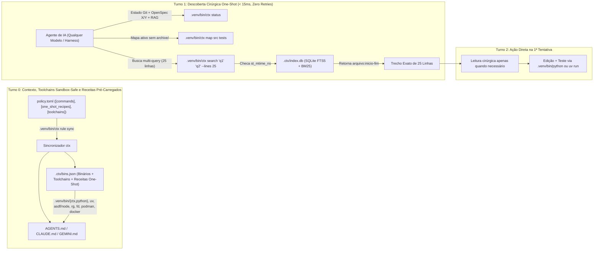
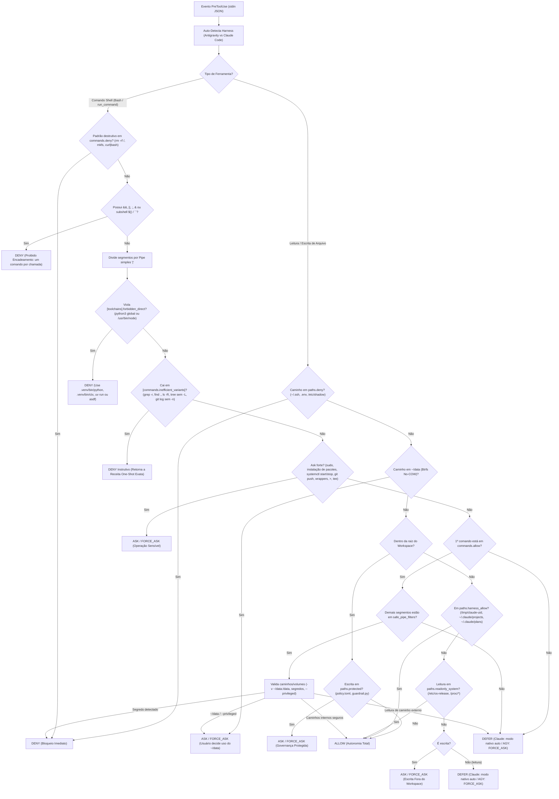
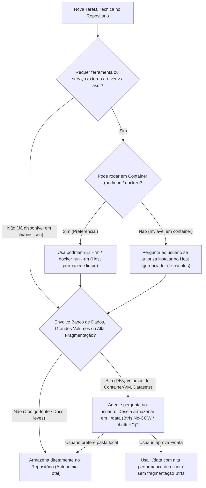

# Pacote Autonomia e Segurança — Guia de Arquitetura

Descoberta One-Shot com RAG local (`ctx`), cache de binários e receitas, toolchains Sandbox-Safe e guardrail multi-harness.

> **Agente de IA instalando o pacote em um projeto?** Este guia é a referência conceitual. Para instalar, siga o [`INSTALL.md`](INSTALL.md) deste pacote (curto, imperativo, com regras de confirmação) — URL fixada: `https://raw.githubusercontent.com/douglaspands/agent-harness-hub/v0.3.0/pacotes/autonomia-e-seguranca/INSTALL.md`. O código vem do pacote versionado via `ctx init`; não reescreva arquivos a partir deste texto.

Este guia é **100% agnóstico de repositório** e documenta a arquitetura completa, o racional técnico de cada ferramenta escolhida, os diagramas de fluxo (incluindo **Execução One-Shot / Zero-Retry**, **Coaching de Eficiência** e **bloqueio de encadeamento no shell**) e o passo a passo para replicar o motor **`ctx`** em **qualquer outro repositório ou projeto** em menos de 2 minutos.

---

## 1. Visão Geral da Arquitetura e Descoberta One-Shot em 1 Turno

O sistema foi desenhado com **zero dependências externas** (100% biblioteca padrão do Python 3.11+: `sqlite3`, `ast`, `tomllib`, `shlex`, `pathlib`) para eliminar cinco gargalos clássicos de agentes de IA em qualquer modelo (de modelos leves/rápidos a modelos de fronteira) e qualquer harness (Antigravity/AGY, Claude Code, CLI):

1. **Fim da exploração cega e do ruído de arquivos mortos (`ctx status`, `ctx map` e `ctx search` em `< 15ms`)**:
   - **Visão Consolidada One-Shot (`ctx status`)**: Em 1 única chamada (`~6ms`), o agente obtém o estado do Git (`status -s -b`), as changes OpenSpec ativas (com progresso `X/Y tasks` e próximas tarefas pendentes) separadas das arquivadas (`openspec/changes/archive/`), e a saúde do índice FTS5 e cache de binários.
   - **Mapa Estrutural Multi-Alvo e Sem Ruído (`ctx map [subpaths...]`)**: Aceita múltiplos subcaminhos na mesma chamada (ex.: `.venv/bin/ctx map src scripts tests`), oculta automaticamente `openspec/changes/archive/` por padrão (`--include-archive` opcional) e ordena diretórios de código ativo (`src/`, `scripts/`, `tests/`, changes ativas) antes de documentação secundária.
   - **Busca Local FTS5/BM25 Multi-Query (`ctx search <q1> [q2 ...] --lines 25`)**: O indexador (`src/ctx/rag.py`) divide arquivos Markdown por seções (`#`, `##`, `###`) e arquivos Python pela árvore sintática (`ast.ClassDef`, `ast.FunctionDef`, `ast.AsyncFunctionDef`), gravando em `.ctx/index.db` (SQLite FTS5 com tokenizador `unicode61 remove_diacritics 2` e ranking **BM25**). Suporta múltiplas queries simultâneas, filtro `--path <subpath>` e preview padrão de **25 linhas** (`--lines 25`), eliminando re-execuções para ler o restante da função/seção.
2. **Fim das buscas repetitivas por binários e das re-execuções com mais flags (`ctx bins`, `.ctx/bins.json` e `[commands.one_shot_recipes]`)**:
   - O comando `.venv/bin/ctx bins` (executado automaticamente no `ctx rule sync`) pré-resolve e persiste todos os caminhos de binários, toolchains e **Receitas One-Shot** em `.ctx/bins.json` e injeta a tabela diretamente no `AGENTS.md` (**Turno 0**).
3. **Enforcement Agnóstico de Toolchains Sandbox-Safe (`[toolchains]` em `policy.toml`) — Zero Retries de `exit 127`**:
   - Em sandboxes restritas onde `~/.local/bin/uv` não está montado, exigir apenas `uv run` causava falha `exit 127` na 1ª tentativa seguida de retries.
   - A seção `[toolchains.python]` opera de forma **Sandbox-Safe**: bloqueia estritamente binários globais do sistema (`python`, `python3`, `/usr/bin/python*`, `/usr/local/bin/python*`), mas legitima tanto `uv run` quanto os executáveis locais do próprio ambiente virtual do workspace (`.venv/bin/ctx` e `.venv/bin/python`), garantindo acerto imediato na **1ª tentativa** dentro ou fora de sandbox. Para Node.js, exige os shims do `asdf` (`~/.asdf/shims` ou `asdf exec`).
4. **Guardrail com Coaching de Eficiência One-Shot (`[commands.inefficient_variants]`)**:
   - Quando um agente tenta rodar um comando "cru" ou sem escopo que geraria poluição de contexto ou uma 2ª chamada (`grep -r`, `find .`, `ls -R`, `tree` sem `-L`, `git log` sem `-n`), o `scripts/guardrail.py` retorna **`deny` instrutivo** informando exatamente a Receita One-Shot parametrizada (`rg -n --heading -C 2`, `fd --max-depth 3 --exclude archive`, `tree -L 2 --dirsfirst -I ...`, `git log --oneline --decorate -n 10`).
5. **Autonomia com Segurança Multi-Harness (`scripts/guardrail.py` em `< 5ms`)**:
   - Uma única fonte de verdade (`policy.toml`) compila as regras para Claude Code, Codex, Cursor, Gemini CLI e Antigravity (hooks de cada um + `CLAUDE.md`, `GEMINI.md` e o documento mestre `AGENTS.md`).
   - Comandos encadeados no shell (`&&`, `||`, `;`, `&`, subshells) são **recusados (`deny`)**: cada comando roda numa chamada própria, para ser avaliado e auditado sozinho pelo guardrail (um `cmd_seguro && cmd_perigoso` não passa escondido).
   - **Menos prompts sem perder segurança (decisão `defer`)**: casos de baixo risco (comando ou filtro de pipe fora da whitelist, leitura fora do workspace) não geram mais `ask` no Claude Code — o hook devolve o controle ao modo de permissão nativo (`--permission-mode auto` + regras do `.claude/settings.json`). O `ask` forte continua para operações sensíveis (ver Seção 3).

### Diagrama 1: Arquitetura de Descoberta One-Shot em 1 Turno (Status + Mapa + Busca Multi-Query + Receitas One-Shot)



---

## 2. Vantagens da Abordagem e Motivo Técnico da Escolha de Cada Ferramenta

Cada componente desta arquitetura foi selecionado por motivos técnicos estritos de **latência, portabilidade, isolamento e durabilidade do sistema operacional**:

| Componente / Ferramenta | Papel na Arquitetura | Motivo Técnico da Escolha e Vantagens |
| :--- | :--- | :--- |
| **SQLite FTS5 + BM25 (`sqlite3` stdlib)** | Motor de busca local multi-query (`.ctx/index.db`) | Nativo no Python (zero pacotes C/Rust externos, zero containers ou GPU para embeddings). Com WAL ativado e tokenizador `unicode61 remove_diacritics 2`, entrega buscas multi-query rankeadas por BM25 em **2ms a 12ms**, lidando com acentuação em português e identificadores de código. |
| **Subcomando `ctx status` + `ctx map` sem `archive/`** | Visão consolidada One-Shot (`src/ctx/rag.py`) | Elimina 3 a 4 chamadas separadas (`git status`, `fd openspec`, leitura de `tasks.md`) e impede que changes antigas em `openspec/changes/archive/` consumam o orçamento de linhas do mapa estrutural. |
| **Chunking por AST (`ast` stdlib) + Cabeçalhos Markdown (H1-H3)** | Indexação estrutural (`src/ctx/rag.py`) | O parser AST do Python extrai `ClassDef` e `FunctionDef` com linhas iniciais e finais exatas (`arquivo:inicio-fim`), e o preview padrão de 25 linhas (`--lines 25`) entrega a função/seção inteira em 1 única chamada. |
| **Cache de Binários e Receitas One-Shot (`.ctx/bins.json` / `ctx bins`)** | Resolução prévia de ferramentas, runtimes e flags ideais | Elimina sondagens (`which`, `whereis`) e re-execuções por falta de flags. O agente já recebe no Turno 0 os caminhos de `.venv/bin/ctx`, `.venv/bin/python`, `uv`, `asdf`, `node`, `rg`, `fd`, `podman`, `docker` e as Receitas One-Shot. |
| **`uv` + `.venv/bin/{ctx,python}` (`[toolchains.python]` Sandbox-Safe)** | Execução Python instantânea e imune a bloqueios de sandbox | `uv` gerencia o `.venv` isolado com velocidade em Rust; legitimar `.venv/bin/ctx` e `.venv/bin/python` junto ao `uv run` garante **zero falhas `exit 127`** quando a sandbox do harness não monta `~/.local/bin/uv`, mantendo bloqueados (`deny`) os binários globais `/usr/bin/python*`. |
| **`asdf` (`~/.asdf/shims`)** | Gerenciador canônico de versões para Node.js e outros runtimes (`[toolchains.nodejs]`) | Garante que `node`, `npm`, `npx` e outras linguagens rodem exatamente na versão declarada pelo projeto/usuário via shims do `asdf`, bloqueando binários globais defasados em `/usr/bin/node`. |
| **`rg` (ripgrep), `fd` (fd-find), `tree -L 2`, `jq`** | Ferramentas nativas de alta velocidade + Coaching One-Shot | Escritas em Rust/C, respeitam `.gitignore` por padrão e, combinadas com o coaching de `[commands.inefficient_variants]` no `guardrail.py`, substituem comandos lentos/verborrágicos (`grep -r`, `find .`, `ls -R`). |
| **`podman` e `docker` (Política Container-First)** | Execução isolada de ferramentas e serviços externos | Evita instalar pacotes, bancos de dados ou runtimes diretamente no sistema operacional host (`dnf install`, `apt install`, `brew install`…), mantendo a máquina limpa, reproduzível e imune a conflitos de bibliotecas. O Podman opera nativamente em modo *rootless*. |
| **Pasta de dados No-COW (ex.: `~/data`) no Btrfs com `chattr +C`** | Armazenamento de alta performance para dados pesados/fragmentados (opcional; caminho configurável em `[storage.btrfs_nocow]`) | Sistemas de arquivos **Copy-on-Write** como o **Btrfs** (padrão em várias distribuições Linux) têm um custo alto nesse tipo de carga. Em cargas de escrita aleatória intensa (bancos de dados SQLite/PostgreSQL/vetoriais, imagens de containers/VMs e grandes volumes), o Copy-on-Write gera severa fragmentação de extents e amplificação de escrita (*write amplification*). O atributo `chattr +C` (`NOCOW`) em `~/data` desativa o Copy-on-Write apenas nessa pasta, entregando performance de escrita contígua próxima a disco bruto. |

---

## 3. Fluxo Decisório do Guardrail Multi-Harness, `[toolchains]` Sandbox-Safe e Coaching One-Shot (`scripts/guardrail.py`)

O hook universal `scripts/guardrail.py` intercepta chamadas `PreToolUse` tanto no **Antigravity (AGY)** quanto no **Claude Code**, executando em menos de 5ms sem dependências externas:

- **Auto-detecção de protocolo**:
  - Se o evento vier do **Antigravity**, retorna estritamente `{"decision": "allow" | "force_ask" | "deny", "reason": "..."}` (compatível com o parser `protojson` estrito do AGY).
  - Se o evento vier do **Claude Code**, retorna o objeto `hookSpecificOutput` com `permissionDecision: "allow" | "ask" | "deny"` — ou um objeto vazio `{}` quando a decisão é `defer`.
- **Decisão `defer` (delegação ao harness em casos de baixo risco)**:
  - Internamente o guardrail usa uma 4ª decisão, `defer`, para situações que antes viravam `ask` mas não oferecem risco real: comando fora de `commands.allow`, filtro de pipe fora de `safe_pipe_filters`, aspas não analisáveis e **leitura** fora do workspace.
  - **Claude Code**: `defer` vira `{}` (sem `permissionDecision`), então o Claude Code segue o próprio fluxo (modo `auto`/`acceptEdits` + regras de `.claude/settings.json`). Resultado: bem menos prompts de confirmação.
  - **Antigravity**: `defer` é mapeado para `force_ask` (comportamento original preservado), porque o AGY pode não oferecer um modo `auto` equivalente.
  - **`ask` forte continua valendo nos dois harnesses** para: `sudo`, instalação de pacotes no host (`dnf install`, `apt install`…), `systemctl start/stop/restart`, `git push`, escrita em `paths.protected` (`policy.toml`, `scripts/guardrail.py`, `.agents/hooks.json`, `.claude/settings.json`), qualquer acesso a `~/data`, `--privileged`, wrappers (`env`, `xargs`, `sh -c`…), redirecionamento (`>`), `tee` e **escrita** fora do workspace.
  - Elevação de privilégio, `tee`, `>` e `--privileged` são fixos no guardrail; os demais vêm do `policy.toml` (`commands.ask` e `commands.wrappers`), então cada repositório ajusta a lista sem tocar no código. Redirecionamentos inofensivos (`2>&1`, `>/dev/null`) não contam como escrita.
- **Análise ciente de aspas**: o comando é tokenizado com `shlex` (`punctuation_chars`), então `rg "a|b"` ou `rg "foo;"` não são confundidos com pipe ou encadeamento.
- **Diretórios de trabalho do harness liberados (`paths.harness_allow`)**:
  - Leitura e escrita em `/tmp/claude-<uid>/**` (scratchpad), `~/.claude/projects/**` (memória) e `~/.claude/plans/**` (planos) recebem `allow`. Se `paths.harness_allow` não estiver no `policy.toml`, esses três padrões são usados por padrão.
- **Bloqueio Estrito (`deny`) de Encadeamento de Comandos**:
  - Qualquer comando contendo `&&`, `||`, `;`, `&` (background), quebras de linha ou subshells (`$()`, `` ` ``) recebe **`deny` imediato**, instruindo o agente a executar um comando por chamada.
- **Enforcement Agnóstico de `[toolchains]` Sandbox-Safe (`deny` para globais, `allow` para `.venv/bin/` e `uv run`)**:
  - Invocações diretas de binários globais do sistema (`python`, `python3`, `/usr/bin/python*`, `/usr/bin/node`, `/usr/bin/npm`) recebem **`deny` imediato**.
  - Já `.venv/bin/ctx`, `.venv/bin/python`, `uv run` e shims do `asdf` (`~/.asdf/shims/*`, `asdf exec`) recebem **`allow` imediato**.
- **Coaching de Eficiência One-Shot (`[commands.inefficient_variants]` -> `deny` instrutivo)**:
  - Intercepta chamadas que desperdiçam turnos ou estouram a janela de contexto (`grep -r`/`grep -R`, `find .`, `ls -R`, `tree` sem `-L`, `git log` sem `-n`) e retorna `deny` contendo a **Receita One-Shot** exata para o agente rodar na 1ª tentativa.
- **Suporte inteligente a Pipes Seguros de Leitura (`allow`)**:
  - Um pipe simples `comando_allow | filtro_seguro` (onde o filtro pertence a `safe_pipe_filters`: `head`, `tail`, `rg`, `grep`, `wc`, `sort`, `uniq`, `jq`, `cut`, `tr`) é aprovado automaticamente (`allow`).

### Diagrama 2: Fluxo Decisório do Hook `scripts/guardrail.py` (Com `[toolchains]`, Coaching One-Shot e Bloqueio de Encadeamento)



---

## 4. Estratégia Container-First (`podman`/`docker`) e Armazenamento Btrfs (`~/data`)

A política estabelece duas regras operacionais de infraestrutura que protegem o sistema host e maximizam a performance de I/O:

1. **Regra Container-First (`[containers]` no `policy.toml`)**:
   - Precisa rodar um banco de dados (PostgreSQL, Redis, Qdrant), um linter específico, um conversor multimídia ou um runtime que não está no `.venv` nem no `asdf`?
   - **1ª Opção (Automática)**: Executar via container efêmero com `podman run --rm ...` ou `docker run --rm ...` montando apenas o diretório necessário do repositório.
   - **Exceção (Com Confirmação)**: Se a ferramenta exigir acesso direto ao hardware/sistema host e não puder rodar em container, o agente **pausa e pergunta ao usuário** se pode instalá-la na máquina host (pelo gerenciador de pacotes da distribuição).
2. **Regra Btrfs No-COW `~/data` (`[storage.btrfs_nocow]` no `policy.toml`)**:
   - A tarefa envolve criar ou manipular bancos de dados pesados, índices vetoriais, volumes de containers/VMs ou arquivos grandes sujeitos a alta fragmentação?
   - O agente **deve perguntar explicitamente ao usuário** se deseja armazenar esses dados em `~/data` (que possui `chattr +C` no Btrfs).
   - `~/data` é o caminho de exemplo usado neste guia; ajuste-o em `[storage.btrfs_nocow]` conforme a máquina de destino. Em sistemas sem Btrfs, a regra pode ser omitida.
   - O guardrail mantém `~/data` com decisão `ask` / `force_ask`, garantindo que o usuário tenha sempre a palavra final.

### Diagrama 3: Fluxo Container-First e Decisão de Armazenamento Btrfs (`~/data`)



---

## 5. Arquivos que Compõem o Kit Portável

O `ctx init` (Seção 6) instala estes arquivos em qualquer repositório; esta é a estrutura resultante e a do próprio hub:

```text
meu-repositorio/
├── policy.toml                                  # Fonte única declarativa (allow, one_shot_recipes, inefficient_variants, pipes, ask, wrappers, deny, toolchains, harness_allow, containers, btrfs)
├── scripts/
│   ├── guardrail.py                             # Hook PreToolUse universal (< 5ms, stdlib pura, coaching One-Shot + Sandbox-Safe)
│   └── venv-python                              # Launcher: sempre .venv/bin/python (cria o .venv com uv ou python3 -m venv)
├── src/                                         # (Só no hub ou se vendorizado; nos projetos o motor fica no .venv)
│   └── ctx/
│       ├── __init__.py                          # Descoberta da raiz do workspace a partir do diretório atual
│       ├── __main__.py                          # Permite `python -m ctx` (via .venv/bin/python ou uv run)
│       ├── cli.py                               # Entry point da CLI ctx (init, status, index, search, map, bins, rule, doctor)
│       ├── installer.py                         # `ctx init`: instala/atualiza o pacote em qualquer projeto
│       ├── kit/                                 # Fonte dos arquivos instalados (guardrail, venv-python, policy, skill)
│       ├── rag.py                               # Motor SQLite FTS5/BM25 multi-query + mapa estrutural sem archive/ + status One-Shot
│       └── policy.py                            # Sincronizador multi-harness + cache .ctx/bins.json + doctor
├── bin/
│   └── ctx                                      # (Opcional) wrapper sem instalação; usa scripts/venv-python
├── .agents/
│   └── skills/
│       └── workspace-ctx/
│           └── SKILL.md                         # Skill universal (1º turno One-Shot, toolchains Sandbox-Safe, comandos atômicos, ferramentas de arquivo, Container-First e ~/data)
└── .claude/
    └── skills/
        └── workspace-ctx/
            └── SKILL.md                         # Mesma skill para o Claude Code (copiada no Passo 1)
```

Os arquivos `.agents/hooks.json`, `.claude/settings.json`, `AGENTS.md`, `CLAUDE.md` e `GEMINI.md` **não** precisam ser copiados: o `ctx rule sync` os gera no Passo 4.

---

## 6. Passo a Passo de Replicação Agnóstica (Bootstrap em < 2 Minutos)

### Passo 1: Instalar o motor `ctx` no `.venv` do projeto (fixado por tag)

O motor do pacote é distribuído como pacote Python versionado. Instale-o **no `.venv` do projeto** — nunca no Python global — usando um tag (`v0.3.0`), não `main`:

| Situação | Comandos (um por chamada) |
| :--- | :--- |
| `uv` + `pyproject.toml` | `uv add --dev "agent-harness-hub @ git+https://github.com/douglaspands/agent-harness-hub@v0.3.0"` |
| `uv`, sem `pyproject.toml` (Node, Go, Rust…) | `uv venv .venv` → `uv pip install --python .venv/bin/python "agent-harness-hub @ git+https://github.com/douglaspands/agent-harness-hub@v0.3.0"` |
| **sem `uv`** | `python3 -m venv .venv` → `.venv/bin/python -m pip install "agent-harness-hub @ git+https://github.com/douglaspands/agent-harness-hub@v0.3.0"` |

> **Regra do Python**: sem `uv`, o Python da máquina é usado **apenas** para criar o venv (`python3 -m venv .venv`, liberado em `[toolchains.python].bootstrap_allowed`). Todo o resto roda com `.venv/bin/python`; o guardrail nega qualquer outro uso de `python`/`python3` globais.

### Passo 2: Instalar o pacote com `ctx init`

```bash
.venv/bin/ctx init
```

O comando é idempotente e copia do pacote (não de texto de chat) os arquivos do pacote:

| Arquivo | Comportamento em reinstalações |
| :--- | :--- |
| `scripts/guardrail.py`, `scripts/venv-python` | Sempre atualizados para a versão instalada |
| `policy.toml`, `.claude/skills/workspace-ctx/SKILL.md`, `.agents/skills/workspace-ctx/SKILL.md` | Criados se ausentes; mantidos se já existem (`--force` sobrescreve) |
| `.gitignore` | Acrescenta só o que falta: `.venv/`, `.ctx/`, `.claude/settings.local.json` |
| `.claude/settings.json`, `.agents/hooks.json`, `AGENTS.md`, `CLAUDE.md`, `GEMINI.md` | Gerados pelo `ctx rule sync` (mescla, preserva conteúdo existente) |

Opções: `--target <dir>` (outro diretório), `--runner ctx` (se preferir `uv tool install` em vez do `.venv`), `--no-sync` (só copia os arquivos).

#### Alternativa: vendorizar o código no repositório

Se o projeto não puder ter dependência via git, copie `src/ctx/` para `src/ctx/` do destino e registre o entry point no `pyproject.toml` do destino (`[project.scripts]`):

```toml
[project]
name = "meu-repositorio"
version = "0.1.0"
requires-python = ">=3.11"
dependencies = []

[project.scripts]
ctx = "ctx.cli:main"

[build-system]
requires = ["uv_build>=0.13.0,<0.14.0"]
build-backend = "uv_build"
```

> **Nota**: `setuptools` também funciona como backend (`requires = ["setuptools>=61.0"]`, `build-backend = "setuptools.build_meta"`), com o layout `src/` descoberto automaticamente. Em qualquer backend, rode `uv sync` (ou o primeiro `uv run ctx ...`) para criar o `.venv` e o executável `.venv/bin/ctx`.

> **Nota**: Se o repositório já possuir outro pacote em `src/<outro_pacote>` e usar `uv_build`, adicione no `pyproject.toml`:
> ```toml
> [tool.uv.build-backend]
> module-name = ["<outro_pacote>", "ctx"]
> ```

Depois rode `.venv/bin/ctx init` normalmente (os arquivos do pacote são lidos de `src/ctx/kit/`).

### Passo 3: (Opcional, em máquinas Linux com Btrfs) Preparar a pasta `~/data` com `chattr +C`

Caso replique a arquitetura em um computador cujo `/home` esteja em Btrfs, o atributo `+C` (No-COW) deve ser aplicado no diretório vazio antes de criar arquivos dentro dele:

```bash
mkdir -p ~/data
chattr +C ~/data
lsattr -d ~/data
```

### Passo 4: Sincronizar Políticas, Gerar Cache de Binários, Indexar e Auditar

No diretório do repositório de destino, execute os comandos atômicos (via `.venv/bin/ctx` ou `uv run ctx`):

```bash
.venv/bin/ctx rule sync
```

```bash
.venv/bin/ctx status
```

```bash
.venv/bin/ctx doctor
```

Pronto! O comando `.venv/bin/ctx rule sync` terá criado automaticamente:
- `.ctx/bins.json` com todos os binários, toolchains Sandbox-Safe e Receitas One-Shot resolvidos da máquina;
- `.claude/settings.json` e `.agents/hooks.json` apontando dinamicamente para o `scripts/guardrail.py` do repositório;
- `AGENTS.md`, `CLAUDE.md` e `GEMINI.md` contendo o mapa de binários verificados, o catálogo de Receitas One-Shot, as regras de `[toolchains]` Sandbox-Safe, a regra de comandos atômicos, as ferramentas nativas de arquivo, a política Container-First (`podman`/`docker`) e a instrução de consulta sobre `~/data`.

#### Formato do hook no `.claude/settings.json`

O Claude Code exige que cada entrada de `PreToolUse` tenha um `matcher` (string; vazio casa todas as ferramentas) e uma lista `hooks` com objetos `{"type": "command", "command": ...}`. Um `command` solto direto na entrada é **inválido**: o Claude Code recusa a entrada e, por segurança, deixa de aplicar o arquivo inteiro até a correção. O `ctx rule sync` gera:

```json
{
  "hooks": {
    "PreToolUse": [
      {
        "matcher": "",
        "hooks": [
          { "type": "command", "command": "\"$CLAUDE_PROJECT_DIR/scripts/venv-python\" \"$CLAUDE_PROJECT_DIR/scripts/guardrail.py\"" }
        ]
      }
    ]
  }
}
```

- `$CLAUDE_PROJECT_DIR` faz o hook funcionar mesmo quando a sessão muda de diretório.
- O hook nunca usa o Python global: `scripts/venv-python` executa `.venv/bin/python` e, se o `.venv` ainda não existir, cria-o uma única vez (com `uv venv`, ou com `python3 -m venv` quando não há `uv`), com lock em `.ctx/` para chamadas concorrentes. O `guardrail.py` só usa a biblioteca padrão, então não precisa de nada instalado no venv.
- O sync **mescla** o hook no arquivo existente: preserva `permissions`, `env` e outros hooks, e migra entradas no formato legado. O `ctx doctor` valida esse formato (verificação "Hook Claude Code válido").

### Passo 5: Permissões por projeto (não no `~/.claude/settings.json` global)

Declare comandos de diagnóstico em `commands.allow` do `policy.toml` do projeto, e não em `permissions.allow` do `~/.claude/settings.json` global. O `ctx rule sync` gera o `.claude/settings.json` do projeto, então cada repositório leva suas próprias regras e o arquivo global fica só com preferências pessoais (por exemplo, hooks de notificação). Exemplo de comandos de diagnóstico somente leitura (ajuste ao gerenciador de pacotes e às ferramentas da distribuição de destino):

```toml
[commands]
allow = [
    "systemctl is-active", "systemctl is-enabled", "systemctl is-failed", "systemctl list-units",
    "journalctl -u", "journalctl -b", "journalctl -p",
    "hostnamectl", "ip addr", "ip -br addr",
    # Fedora/RHEL: "rpm -q", "dnf list", "dnf info", "dnf search"
    # Debian/Ubuntu: "dpkg -l", "apt list", "apt show", "apt search"
    # ...
]
```

### Passo 6: Iniciar o harness no modo de permissão certo

O ganho da decisão `defer` só aparece se o harness tiver um modo de permissão nativo que aproveite a delegação:

- **Claude Code**: inicie com `claude --permission-mode auto` (opcionalmente com `-c` para retomar a última conversa da pasta). O guardrail continua bloqueando (`deny`) e confirmando (`ask` forte) o que é sensível; o resto fica com o modo `auto`.
- **Antigravity (`agy`)**: se o modo `--mode auto` não estiver disponível, a autonomia vem de `permissions.allow` no `settings.json` do Antigravity CLI, com regras `command(...)` espelhando os comandos de leitura/diagnóstico de `commands.allow`. Para o AGY, `defer` continua sendo `force_ask`.

---

## 7. Como Configurar `[toolchains]` Sandbox-Safe e Receitas One-Shot no `policy.toml`

A seção `[toolchains]` e as tabelas `[commands.one_shot_recipes]` e `[commands.inefficient_variants]` em `policy.toml` são totalmente agnósticas:

### Exemplo de Configuração em `policy.toml`

```toml
[commands.one_shot_recipes]
ctx_status = ".venv/bin/ctx status"
ctx_map = ".venv/bin/ctx map [subcaminhos...]"
ctx_search = ".venv/bin/ctx search \"<q1>\" [\"<q2>\" ...] --lines 25"
rg_context = "rg -n --heading -C 2 \"<padrao>\" [caminho]"
fd_scoped = "fd --max-depth 3 --exclude archive \"<padrao>\" [caminho]"
tree_compact = "tree -L 2 --dirsfirst -I \".venv|__pycache__|.git|.ctx|archive\""
git_status_short = "git status -s -b"
git_log_compact = "git log --oneline --decorate -n 10"

[commands.inefficient_variants]
"grep -r" = "Use a Receita One-Shot: rg -n --heading -C 2 \"<padrao>\" [caminho] (ou .venv/bin/ctx search \"<termo>\" --lines 25)"
"find ." = "Use a Receita One-Shot: fd --max-depth 3 --exclude archive \"<padrao>\" [caminho] (ou .venv/bin/ctx map [subcaminhos...])"
"ls -R" = "Use a Receita One-Shot: tree -L 2 --dirsfirst -I \".venv|__pycache__|.git|.ctx|archive\" (ou .venv/bin/ctx map)"
tree_unbounded = "Sempre passe -L <nivel> no tree. Receita One-Shot: tree -L 2 --dirsfirst -I \".venv|__pycache__|.git|.ctx|archive\""
git_log_unbounded = "Sempre limite o git log com -n <N>. Receita One-Shot: git log --oneline --decorate -n 10"

[commands]
# Wrappers que ocultam o comando real: sempre "ask forte"
wrappers = ["env", "xargs", "sh", "bash", "zsh", "nohup", "timeout", "nice", "exec", "eval", "command", "busybox"]

[paths]
# Diretórios de trabalho do harness (padrão quando omitido); {uid} vira o UID do usuário
harness_allow = ["/tmp/claude-{uid}/**", "~/.claude/projects/**", "~/.claude/plans/**"]

[toolchains.python]
canonical_runner = "uv run"
sandbox_runners = [".venv/bin/ctx", ".venv/bin/python", ".venv/bin/python3"]
# Sem uv, o Python global pode APENAS criar o .venv; todo o resto usa .venv/bin/python
bootstrap_allowed = ["python3 -m venv .venv", "python -m venv .venv"]
manager = "uv"
venv_path = ".venv"
forbidden_direct = [
    "python",
    "python3",
    "/usr/bin/python",
    "/usr/bin/python3",
    "/usr/local/bin/python",
    "/usr/local/bin/python3",
]
reason = "Python deve ser executado via 'uv run' ou via binários locais '.venv/bin/ctx' / '.venv/bin/python' (Sandbox-Safe), nunca invocando python/python3 global do sistema diretamente."

[toolchains.nodejs]
canonical_runner = "asdf exec"
manager = "asdf"
shims_dir = "~/.asdf/shims"
forbidden_direct = [
    "/usr/bin/node",
    "/usr/bin/npm",
    "/usr/bin/npx",
    "/usr/local/bin/node",
]
reason = "Node.js/npm/npx devem usar a versão gerenciada pelo asdf (~/.asdf/shims ou 'asdf exec')."
```

---

## 8. Como Medir Performance e Economia de Tokens

### Medição de Latência Local (`< 15ms`)
Os comandos `ctx status`, `ctx search`, `ctx map` e `ctx bins` informam o tempo exato de execução em milissegundos no cabeçalho da saída:

```bash
.venv/bin/ctx status
```

```bash
.venv/bin/ctx map src scripts tests
```

```bash
.venv/bin/ctx search "toolchains" "guardrail" --path src --lines 25
```

- **Status One-Shot (`ctx status`)**: **4ms a 10ms** (consolida Git, OpenSpec ativas/arquivadas e saúde RAG/bins).
- **Mapa Estrutural (`ctx map`)**: **10ms a 25ms** (oculta `archive/` e prioriza código ativo).
- **Busca Multi-Query (`ctx search`)**: **2ms a 12ms** em índice quente (retorna trechos de 25 linhas para múltiplas queries em 1 chamada).

### Comparativo de Eficiência Operacional
| Métrica | Sem `ctx` (Abordagem Tradicional) | Com `ctx` One-Shot (`status` + `map` + `search` + `toolchains` Sandbox-Safe + Coaching) |
| :--- | :--- | :--- |
| Descobrir estado do Git + progresso de tasks OpenSpec | 3 a 5 comandos (`git status`, `fd`, `read_file`) | **1 comando** (`.venv/bin/ctx status` em ~6ms) |
| Turnos até achar a linha exata de múltiplos conceitos | 4 a 8 turnos (`ls`, `find`, `rg`, `read_file` completo) | **1 comando** (`.venv/bin/ctx search "q1" "q2" --lines 25`) |
| Retries por falha de sandbox (`uv: command not found` / `exit 127`) | 1 a 2 retries antes de achar `.venv/bin/` | **Zero** (`.venv/bin/ctx` e `.venv/bin/python` são nativamente permitidos e documentados) |
| Re-execução de comandos para adicionar mais flags | Frequente (`tree` → `tree -L 2`, `git log` → `git log -n 10`) | **Zero** (Receitas One-Shot + Guardrail Coaching interceptam chamadas incompletas) |
| Prompts de confirmação em comandos de baixo risco | Um `ask` para cada comando fora da whitelist ou leitura externa | **Delegados** ao modo `auto` do Claude Code (`defer`); `ask` forte só para operações sensíveis |
| Comandos perigosos escondidos em encadeamentos | `cmd_seguro && cmd_perigoso` aprovado como um todo | **Bloqueado**: um comando por chamada, cada um avaliado pelo guardrail |
| Poluição do sistema operacional host | Instalações globais avulsas (`dnf`/`apt`/`pip`) | **Zero** (Container-First via `podman`/`docker`) |
| Degradação Btrfs em bancos de dados e volumes | Alta fragmentação por Copy-on-Write | **Eliminada** via prompt para uso de `~/data` (`chattr +C` / No-COW) |

---

## 9. Suporte Multi-Harness (Claude Code, Codex, Cursor, Gemini CLI, Antigravity)

O mesmo `scripts/guardrail.py` atende todos os harnesses: ele detecta o harness pelo formato do evento e responde no protocolo de cada um. O `ctx rule sync` gera o hook no arquivo de configuração **do projeto** de cada harness listado em `[harnesses].enabled`, mesclando com o que já existe (outras chaves e hooks de terceiros são preservados).

| Harness | Arquivo do projeto | Evento(s) | Resposta de bloqueio | `ask` | Observações |
| :--- | :--- | :--- | :--- | :--- | :--- |
| Claude Code | `.claude/settings.json` | `PreToolUse` (todas as ferramentas) | `hookSpecificOutput.permissionDecision: "deny"` | Sim | `defer` → `{}` (segue o modo de permissão nativo) |
| Codex | `.codex/hooks.json` | `PreToolUse`, matcher `^(Bash\|apply_patch)$` | `hookSpecificOutput.permissionDecision: "deny"` | **Não** | `apply_patch` é avaliado pelos arquivos do patch; hook do projeto precisa ser confiado em `/hooks`; sem variável de raiz → resolve via `git rev-parse --show-toplevel` |
| Cursor | `.cursor/hooks.json` (`version: 1`) | `beforeShellExecution`, `beforeReadFile` | `{"permission": "deny", "user_message", "agent_message"}` | Sim | `defer` → `ask`; JSON inválido bloqueia a ação; escritas não têm evento "before" → só instruções |
| Gemini CLI | `.gemini/settings.json` | `BeforeTool` (todas) | `{"decision": "deny", "reason"}` | Não documentado | Hooks de projeto são "fingerprinted": mudança no comando pede nova aprovação |
| Antigravity | `.agents/hooks.json` | `PreToolUse` | `{"decision": "deny"}` / `force_ask` | `force_ask` | Formato mantido da v0.1; ainda não validado contra documentação oficial |

**`ask` em harnesses sem suporte (Codex, Gemini CLI):** devolver um valor não suportado faz o hook falhar e a ação **seguir** (fail-open). Por isso `[harnesses.<nome>].ask_fallback = "deny"` (padrão) converte o `ask` em `deny` com o motivo e a instrução "peça ao usuário para executar ou aprovar". Use `"allow"` só se preferir confiar no modo de aprovação do próprio harness.

**Limites honestos:** o próprio Codex avisa que hooks de ferramenta são "um guardrail útil, não uma fronteira completa de enforcement"; no Cursor, `ask` em `beforeShellExecution` teve relato de não pedir confirmação na versão 2.4.21. Combine o guardrail com a sandbox/aprovação nativa de cada harness.

Fontes: [Codex hooks](https://developers.openai.com/codex/hooks), [Cursor hooks](https://cursor.com/docs/agent/hooks), [Gemini CLI hooks](https://geminicli.com/docs/hooks/reference/), [relato do `ask` no Cursor 2.4.21](https://forum.cursor.com/t/hooks-ask-permission-broken-in-2-4-21/150020).

---

## 10. Ferramentas Nativas de Arquivo (`[file_tools]`) e Validação com `ctx metrics`

Agentes frequentemente leem (`cat`, `head`, `tail`, `sed -n`) e escrevem arquivos (`sed -i`, `>`, `>>`, heredoc, `tee`) pelo shell. Isso despeja arquivos inteiros no contexto, gera prompts de permissão, escapa das checagens de caminho das ferramentas de arquivo e perde a verificação de trecho exato das ferramentas de edição. Parte da causa é o próprio harness: no Claude Code em modo auto, o prompt de sistema permite usar o Bash para leituras, então instruções do projeto competem com ele.

A solução tem três camadas:

1. **Instrução por harness** (sempre ativa): seção "Ferramentas Nativas de Arquivo" no `CLAUDE.md` (`Read`/`Edit`/`Write`), `GEMINI.md` (`read_file`/`replace`/`write_file`) e `AGENTS.md` (condicional: harnesses só com shell, como o Codex, leem trechos delimitados e escrevem via `apply_patch`). Também disponível como prompt avulso: `tooling/ferramentas-nativas-de-arquivo`.
2. **Coaching no guardrail** (`[file_tools] mode = "coach"`): leitura/escrita via shell recebe `deny` com a ferramenta certa do harness na mensagem. Exceções: `git show X | head`, `tail -f`, `>/dev/null`, `2>&1`. No Codex só a escrita é orientada (ele não tem ferramenta de leitura).
3. **Desligável** com `mode = "off"` (padrão).

**Plano de validação:**

| Fase | O quê | Critério |
| :--- | :--- | :--- |
| 0. Linha de base | `.venv/bin/ctx metrics` com `mode = "off"` em ≥ 5 sessões reais | Números de leitura/escrita via shell por sessão |
| 1. Testes | Matriz de comandos em `tests/test_harnesses.py` (leituras, escritas, falsos positivos, resposta por harness) | 100% passando |
| 2. Só instrução | 1 semana com `mode = "off"` (camada 1 já ativa) | Quanto a instrução sozinha reduz |
| 3. Coaching | 1 semana com `mode = "coach"` | Leituras via shell < 5%, escritas via shell = 0, nenhum loop de `deny`, `Deny coach` por sessão caindo |
| 4. Decisão | Comparar fases 2 e 3 no `ctx metrics` | `coach` vira padrão do template só se superar a fase 2 sem falsos positivos |

```bash
.venv/bin/ctx metrics            # tabela por sessão (padrão: ~/.claude/projects/<projeto>)
.venv/bin/ctx metrics --json     # para comparar fases
```

O `ctx metrics` usa o mesmo classificador do guardrail, então "via shell" na métrica é exatamente o que o modo `coach` bloquearia. Ele lê transcripts do Claude Code; para outros harnesses, a medição fica para quando os formatos de transcript forem documentados.
